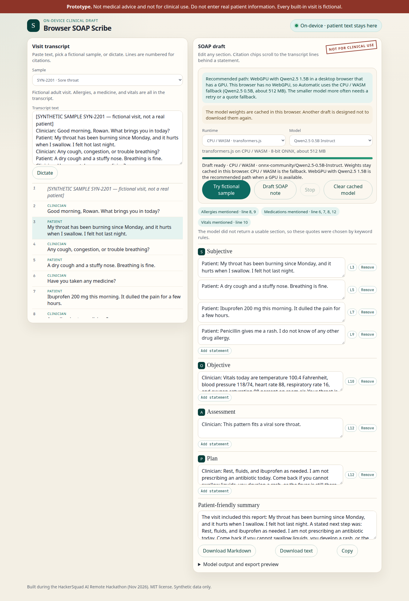
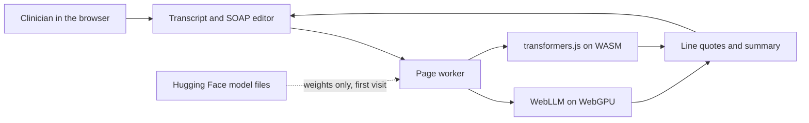

# Browser SOAP Scribe

A clinician can paste a visit transcript, pick a fictional sample, or dictate, and a small language model running **in the browser** drafts a SOAP note (Subjective, Objective, Assessment, Plan) plus a short patient-friendly summary.

The visit text is not uploaded. There is no note API and no analytics. Model weights are downloaded once and cached in the browser.

**Live app:** [https://shomirb.github.io/browser-soap-scribe/](https://shomirb.github.io/browser-soap-scribe/)

The site is static. After it loads, the draft runs on the visitor’s device. The first run downloads the model (about 1 GB on the recommended WebGPU path, about 512 MB on CPU). Later drafts in the same browser reuse the cache.



Built during the HackerSquad AI Remote Hackathon (Nov 2026).

## Problem

Writing a SOAP note means turning a messy conversation into four sections someone else can read. That takes time at the end of a visit, and the usual assistants do it by sending the transcript to a cloud model. A real visit should not have to leave the room for a first draft.

## Who it is for

The intended user is a clinician who wants a **starting draft** they can edit, with a way to see which lines of the conversation a statement came from, and a checklist for allergies, medicines, and vitals the transcript never mentioned.

This repository is a prototype for that workflow. It is not a medical device, not medical advice, and not for clinical use. The built-in visits are fictional. Do not type real patient information into it.

## How the AI is used, and why it stays on the device

**WebGPU is the recommended path.** Automatic mode uses WebLLM with Qwen2.5 1.5B when the browser has a GPU. The page says so. That model drafts each SOAP section from the full numbered transcript. If a reply has no grounded bullet, it retries once with a stricter “one bullet per line” instruction.

**CPU / WASM is the fallback** (Qwen2.5 0.5B, about 512 MB) when WebGPU is missing or the GPU load fails. That smaller model does not reliably draft from the whole visit. It rewrites one transcript line at a time: a keyword pass picks the lines for the section, a short worked example shows the bullet shape, and generation is capped at 40 tokens. A sentence is kept only when most of its words are already in that line and it does not attach a number to the wrong measurement. Otherwise the note uses the transcript line itself and the screen says so. A patient summary is kept only when it stays inside those sentences.

Keeping the model in the browser is the product, not a demo trick. A cloud SOAP assistant would send the transcript to someone else’s server. Here the only network traffic the app is designed to make is the first download of model weights and runtime files.

| Runtime | Engine | Default model | When it is used |
| --- | --- | --- | --- |
| WebGPU (recommended) | [WebLLM](https://github.com/mlc-ai/web-llm) (`@mlc-ai/web-llm`) | `Qwen2.5-1.5B-Instruct-q4f16_1-MLC`, about 1 GB | Browsers with a working WebGPU adapter. Also selectable: Qwen2.5 0.5B and Llama 3.2 1B, same family of MLC builds. |
| CPU / WASM (fallback) | [transformers.js](https://huggingface.co/docs/transformers.js) | `onnx-community/Qwen2.5-0.5B-Instruct` (8-bit ONNX, about 512 MB) | No WebGPU, or the GPU model fails to load. |

Qwen weights are Apache-2.0. The Llama 3.2 build may be license-gated on Hugging Face, so a cold download of that option can fail until the license is accepted there. No API key is required for the default models.

## Architecture



- The page is a static Vite app: `index.html`, CSS, and ES modules. No application server.
- `src/llm.worker.js` loads either WebLLM or transformers.js and runs generation off the main thread.
- `src/privacy.js` wraps `fetch`, XHR, `sendBeacon`, and `WebSocket` in the page and in the worker. A request whose URL or body contains a stretch of the transcript is blocked and counted.
- `src/soap.js` numbers lines, flags missing allergies / medicines / vitals, checks that a drafted sentence still matches its line, and exports Markdown and plain text.
- WebLLM needs `SharedArrayBuffer`. Local Vite sends the COOP/COEP headers. GitHub Pages cannot, so `coi-serviceworker` (MIT) reloads the page once and adds those headers.
- Weights are cached by the runtimes (Cache API and, for WebLLM, IndexedDB). “Clear cached model” deletes those entries.

## Run it locally

Requires Node.js 20 or newer. No environment variables and no API keys.

```bash
npm ci
npm run dev
```

Open the URL Vite prints (usually `http://127.0.0.1:5173`). Then:

```bash
npm test          # parser, checklist, citation, and privacy-classifier tests
npm run build
npm run preview   # http://127.0.0.1:4173 with the same isolation headers
npm run test:e2e  # headless Chrome, including a real WASM draft
```

Click **Try fictional sample**. That loads the sore-throat visit and starts a draft. The first run shows download size and progress. If the page reports an error, the message says what to do next, including switching to the CPU model. Dictation uses the browser Web Speech API and is optional: Chrome’s implementation can send microphone audio to a speech service, and the button says so before it starts.

## Verify that the visit is not sent

1. Open DevTools → Network.
2. Pick a sample. You should not see a request whose payload contains the transcript.
3. Draft once and let the weight files finish. Those requests go to Hugging Face (and, on the WebGPU path, a WebLLM runtime file). They are model files, not the note.
4. Clear the Network list, then draft again. The list should stay empty while the note updates. The in-app counter “Requests during the latest draft” includes the first download; the second draft is the check that matters.
5. The privacy log starts when the app script runs. DevTools also shows the initial HTML, CSS, and JS, which the in-app log does not.

The log labels each call it sees as a model file, an app file, an unexpected host, or a blocked call that contained transcript text. The header pill stays on “patient text stays here” unless a blocked or unexpected call is recorded.

## What you can do in the note

- Edit, add, or remove any SOAP statement, and edit the patient summary.
- Click a line chip (`L3`) to highlight that transcript line.
- Read the allergy / medication / vital checklist. It is a text scan, not a model opinion.
- Download Markdown, download plain text, or copy the note. The export repeats the “not for clinical use” line and names the model.

## Limitations

- Prototype only. Not medical advice and not for real patients. This project does not claim the drafts are accurate.
- WebGPU was not available in the headless Chrome used to test this repo, so that path is implemented and labeled, not measured here.
- The 0.5B CPU model often writes a sentence that is not in the line (a diagnosis, an apology, or a different disease). Those sentences are dropped and the transcript line is shown instead. The note says when that happened.
- The patient summary is kept only when it stays inside the drafted sentences. Otherwise it is assembled from those sentences.
- The first download is large (about 512 MB for the CPU model, about 1 GB for Qwen2.5 1.5B on WebGPU) and needs a network. After that, drafts are designed not to send the visit.
- WebGPU needs a capable GPU and cross-origin isolation. The WASM path is slower.
- Dictation, if you turn it on, may leave the device. The note draft does not.
- English only. No EHR connection. No claim of HIPAA compliance or of being a medical device.
- Quotes can repeat when one clinician sentence contains both the impression and the plan.

## License

Original code in this repository is [MIT](LICENSE), Copyright (c) 2026 Shomir Banerjee.

Third-party pieces, under their own licenses: `@mlc-ai/web-llm` (Apache-2.0), `@huggingface/transformers` (Apache-2.0), `coi-serviceworker` (MIT), Qwen2.5 weights (Apache-2.0), and Llama 3.2 weights (Llama community license, only if that model is selected). Model weights are downloaded at runtime and are not vendored here.

## Prior work

None. The application code was written during the HackerSquad AI Remote Hackathon building period in November 2026. Libraries and model weights were not written for this event.
